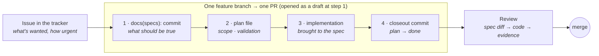

# SpecOps

A Claude Code skill for **spec-driven development**. `specs/` says what the software *should* do and stays authoritative for the life of the system. `plans/` tracks the work in flight that brings the code into line with the specs, one bounded chunk at a time, and freezes as the record of what got built. Your issue tracker stays the backlog.

Specs are written primarily for the agents doing the work: they are how an implementer tells an intended behavior from an accidental one, and how a decision made in one session survives into the next. People read them when they need to know what was agreed; they do not need to read them to use the project.

## The loop, in one picture

Every chunk of work rides **one branch and one PR, framed around the feature that will ship**. The PR opens early with only the spec and plan aboard, picks up the implementation on the same branch, and merges once the plan is complete.



Spec-only PRs are not a thing here. The two cases where an unfinished plan sits on the main branch are a bootstrap batch of plans about to be executed, and a proposal whose build waits on an outside party. Everything else that is "planned but not started" is an issue.

## Three artifacts, three questions

| | Issue tracker | `specs/` | `plans/` |
| --- | --- | --- | --- |
| **Answers** | What's wanted, how urgent, what it waits on | What must be true | How we're getting there *now* |
| **Example** | "Exports time out on large stations" | "Export runs async; the screen shows progress and a download link when done" | "Add the job table, the worker, the progress endpoint; validation: a 10k-row export completes and is downloadable" |
| **Written by** | Anyone who notices | The person or agent proposing the change, reviewed on the PR | The implementer, before coding |
| **Read by** | People, to decide what's next | Agents, every time they touch that area; people, when they need the agreed behavior | Agents and reviewers while the work is open; nobody after it freezes |
| **Lives** | Until closed | For the life of the system | Frozen at merge |

A spec carries its own **why**: decisive principles, written down in `specs/principles.md` and referenced into the specs they govern, so the cases no rule enumerated get resolved the way the author would have. And **spec↔code drift is a bug, not debt**: when the two diverge the spec is the authority until a review says otherwise, and a drift auditor keeps them honest.

## If you're a person on a specops project

**You were assigned an issue.** Find the spec for the area (`specs/screens/`, `specs/behaviors/`, `specs/api/`) and read it before anything else; it is the agreed behavior, and the issue is the gap between it and reality. If the fix changes behavior, the spec changes first, as the first commit on your branch. Then write the plan, then the code. If you're working with an agent, ask it to invoke `/specops`; the skill walks it through the same steps.

**You were asked to review a PR.** Read it in the order it was built:

1. The `docs(specs):` commit(s). This is the contract. Is this what we want to be true? Argue here, not in the code.
2. The implementation, checked against the spec rather than against your own preference. If you'd have built it differently but it conforms, that's a spec conversation, not a review block.
3. The plan's **Validation** checklist in the `chore(plans): mark <slug> done` commit at the tip. Every ticked box is a claim the author verified; ask for evidence where it isn't obvious. Unticked boxes should say why.

A PR with no implementation in its future is a mistake under this workflow; send it back.

**You disagree with a spec.** Propose an amendment to the spec. Don't work around it in code and don't let an agent do so either; the next agent will read the spec, not your workaround.

**Two specs conflict.** File it. The drift auditor (`/audit-spec-drift`) and a spec review can sort out which one is authoritative; what shouldn't happen is each implementer picking a side silently.

**You want to know what's in flight.** Run the `specops` CLI (below), or open a session in the repo: the plans dashboard loads at the start of every session once the hook is installed.

## Install

```bash
npx skills add JarvusInnovations/specops            # into the current project (recommended)
npx skills add JarvusInnovations/specops --global   # once, at the user level
```

**Install per-project and commit it.** A project-level install drops the skill into the repo, so the methodology travels with the codebase and every contributor, and every agent they run, works against the same practices. Installing globally only configures your machine. Reach for `--global` for solo use or to try specops out across repos.

The skill lives under [`skills/specops/`](skills/specops/): `SKILL.md` plus its `references/` and the bundled `specops` CLI under `scripts/`. That subtree is all that installs into your project; the rest of this repo only builds and maintains it.

## Set up specops in your project

Once the skill is installed, point the agent at your project with one prompt. It works for a new or existing codebase:

```
/specops set this project up for spec-driven development: scaffold specs/ and plans/,
seed principles.md and architecture.md from what we already know, wire up the
spec-drift auditor, and install the project-level plans dashboard session hook.
(For an existing codebase, reverse-engineer the starting specs from the current code.)
```

The agent follows the skill's setup flow; see [`SKILL.md`](skills/specops/SKILL.md) for the checklist. Part of it is a **SessionStart hook** that opens every agent session in the repo with the plans dashboard (ready / blocked / recently completed). It is project-scoped, written to the repo's `.claude/settings.json`; commit that file and every contributor's sessions open with the same view.

## The `specops` CLI

A thin **determinism layer** over the files-first `plans/` workflow: it computes readiness, ordering, the dependency graph, and hygiene warnings *across all plan files*, work an agent can't reliably do by eye, and emits compact [TOON](https://toonformat.dev/). It runs on `node ≥ 20` with no `npm install` (deps are inlined into the committed bundle).

```bash
skills/specops/scripts/specops                    # dashboard: ready / blocked / recently completed in ./plans
skills/specops/scripts/specops next               # full readiness breakdown (ready / awaiting / blocked)
skills/specops/scripts/specops next --slugs-only  # ready slugs, one per line (scripting)
skills/specops/scripts/specops dag --fence        # Mermaid graph of the DAG
```

To read or edit a single plan, open its file; the CLI deliberately has no `view` command.

### Developing the CLI

```bash
bun install
bun run build        # rebuild skills/specops/scripts/specops.mjs + splice its SKILL.md command reference
bun run check        # CI gate: fail if the committed bundle or SKILL.md is stale
bun run type-check
```

The bundle is committed and marked `linguist-generated`; commit it together with any `src/cli/` change (`bun run check` enforces this).

## What's inside

| Path | What it is |
| --- | --- |
| [`skills/specops/SKILL.md`](skills/specops/SKILL.md) | The skill itself: philosophy, how to write specs (including encoding principles), the spec directory structure, how agents use specs, and the feature-PR lifecycle. |
| [`skills/specops/references/plans-protocol.md`](skills/specops/references/plans-protocol.md) | The full plan protocol: the feature branch, frontmatter schema, body template, status lifecycle, the closeout commit, and the Follow-ups taxonomy. |
| [`skills/specops/references/parallel-execution-protocol.md`](skills/specops/references/parallel-execution-protocol.md) | How to execute a batch of plans as dependency-gated waves of isolated subagents with a review/merge gate. |
| [`skills/specops/references/spec-drift-auditor.md`](skills/specops/references/spec-drift-auditor.md) | Agent definition (for `.claude/agents/`) that audits `specs/` against the implementation. |
| [`skills/specops/references/audit-spec-drift.md`](skills/specops/references/audit-spec-drift.md) | Slash-command definition (for `.claude/commands/`) that launches the auditor. |
| [`skills/specops/scripts/specops`](skills/specops/scripts/specops) | The `specops` CLI: a self-contained, committed bundle (`specops.mjs`) that queries the plans DAG. |
| [`src/cli/`](src/cli/) | TypeScript source for the CLI; `bun run build` bundles it. *Repo-only, not installed.* |
| [`docs/spec-driven-landscape.md`](docs/spec-driven-landscape.md) | How specops compares with Spec Kit, Kiro, OpenSpec, BMAD, BDD, ADRs, and the work-tracking tools: a comparison chart plus the per-tool reasoning and sources. *Repo-only, not installed.* |

## How specops differs

One opinionated bet: **a spec declares the complete desired state and stays authoritative for the life of the system, while a separate, temporal plan micro-DAG tracks the motion from spec to merged code and freezes as historical record once merged.** Most tools collapse those two layers, and most leave governing principles and spec↔code drift to commit messages and review. The chart and the per-tool reasoning are in [`docs/spec-driven-landscape.md`](docs/spec-driven-landscape.md).
